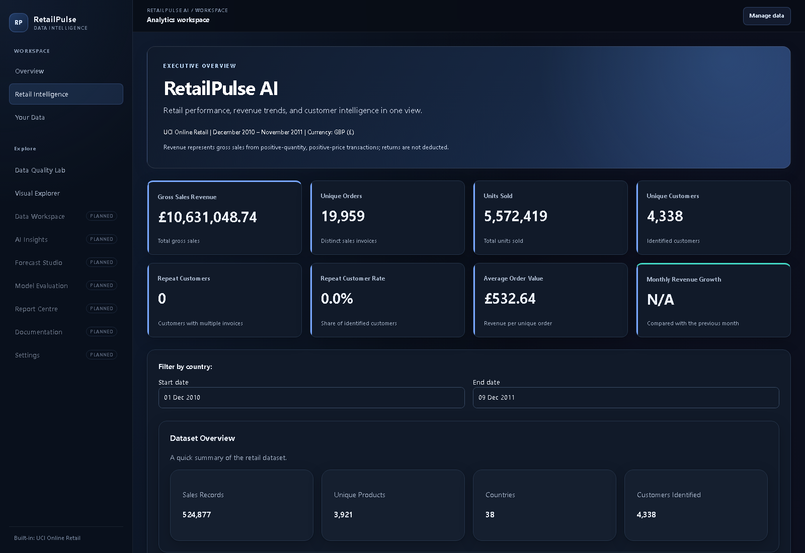

# RetailPulse AI 📊

**Interactive Retail Analytics Dashboard | Python · Plotly Dash · Pandas**

RetailPulse AI is an interactive retail analytics portfolio project built with Python, Pandas, Plotly, and Dash. Its Linux container is configured for Hostless as the primary host, with Render retained as a secondary target. Both use the same application and Dockerfile.

## 📸 Dashboard Preview



Additional views: [Overview](assets/images/retailpulse-overview.png) · [Data Quality Lab](assets/images/retailpulse-data-quality-lab.png) · [Visual Explorer](assets/images/retailpulse-visual-explorer.png).

Screenshots are from the live Hostless deployment running commit `3a62f88`.

## 🎯 Project Objectives

- Analyze historical retail sales and revenue trends.
- Monitor key performance indicators (KPIs) through an interactive dashboard.
- Compare product and country performance.
- Improve data quality through transaction validation and classification.
- Provide filtered transaction data through CSV export.
- Maintain a reproducible workflow with automated tests.

## ✨ Features

### Interactive Sales Dashboard

- **Gross Revenue:** Total revenue for the selected filters.
- **Unique Orders:** Number of distinct invoices.
- **Average Order Value:** Revenue divided by unique orders.
- **Daily and Weekly Performance:** Switch between daily and Monday-start weekly revenue, order, and period-growth analysis; active country and date filters apply.
- **Daily and Weekly Revenue Forecasts:** Compare chronological baselines and forecast up to 28 days or 4 weeks.
- **Top Products:** Identify products with the highest revenue.
- **Product Revenue Declines:** Compare product revenue in the latest two selected daily or weekly periods within the country/date filters.
- **Country Performance:** Compare revenue across countries.
- **Revenue Contribution:** Explore each country's share of revenue.
- **Product Association Analysis:** Surface products frequently purchased together in the same invoice. Exact pair analysis is bounded to 1,000,000 comparisons; narrow country or date filters for larger selections.
- **Top Customer Insights:** Rank the most valuable customer accounts by revenue, invoice count, and average order value.
- **Interactive Filters:** Filter results by country and date range.
- **Reset Filters:** Restore the default country and date selection.
- **CSV Export:** Download filtered sales transactions.
- **Your Data:** Upload a CSV or XLSX file (up to 10 MB) for a bounded column profile, missing-value summary, and sample preview. Excel workbooks support worksheet selection; datasets can be downloaded as CSV.
- **Data Quality Lab:** Review detected column types, missing values, exact duplicates, IQR-based outlier indicators, quality findings, and non-destructive cleaning recommendations for uploaded datasets.
- **Visual Explorer:** Compare retail dimensions with bar, donut, or line charts, select daily or Monday-start weekly time periods, or switch to type-aware universal analysis for uploaded tables, including grouped charts, numeric statistics, deterministic AI insights, machine-learning suitability checks, target-confirmed baseline model evaluations, user-selected K-means clustering and Isolation Forest anomaly analysis, daily/weekly chronological baseline forecasting, correlations, date trends, filters, previews, and CSV export.
- **Report Centre:** Generate a measured PDF report, a multi-sheet Excel workbook with a daily/weekly time-series sheet when date and numeric columns are available, a findings/recommendations CSV, or a CSV copy of the active uploaded dataset.

Uploads are processed in memory and are not written to disk. Uploaded payloads, DataFrames, and derived profiles are not held in process-wide caches after callback use. Flask enforces a request-body ceiling sized for base64 upload and bounded browser-store payloads, while rejecting unbounded callback requests. The workspace accepts up to 100,000 rows, 200 columns, and 2,000,000 cells. CSV parsing checks row and cell bounds before materializing the full dataset; XLSX uploads are limited to 100 MB of declared uncompressed archive contents and checked worksheet dimensions. Uploads that include the eight retail transaction columns listed on the Your Data page can also be activated in Retail Intelligence, with prices interpreted in GBP. Other datasets remain available for inspection in Your Data and Universal Analytics; Retail Intelligence and the Data Quality Lab's retail-specific diagnostics continue to use the built-in UCI data when the upload is not retail-compatible. Refreshing the browser clears session uploads.

### Data Quality and Processing

The data-processing workflow supports schema validation, duplicate removal, date parsing, missing-value handling, revenue calculation, and transaction classification.

Transaction categories include ordinary sales, cancellations, returns or reversals, zero-price records, negative-price reviews, and accounting adjustments.

The dashboard analyzes ordinary sales transactions separately from records that require review.

The **Your Data** page accepts general CSV and XLSX datasets, detects common delimiters and encodings, normalizes blank or duplicate headers, and displays a data profile and bounded preview. Excel workbooks allow worksheet selection. A dataset becomes active in **Retail Intelligence** only when it has the complete RetailPulse transaction schema and can be processed for dashboard analytics; otherwise, the built-in UCI dataset remains active. Use **Use built-in dataset** to clear uploaded datasets and switch back to UCI Online Retail.

The **Data Quality Lab** profiles the uploaded dataset, including schema hints, column statistics, missingness, duplicate rows, potential numeric outliers, and date coverage when detectable. Findings include affected-record counts, severity, investigation guidance, and whether an automatic correction is considered safe; the source data is never silently modified. Retail-specific transaction classifications and cleaning-funnel details appear only for a compatible retail upload. The bundled UCI data is already preprocessed, so raw-file checks are not presented as though they were measured from its source.

The **Visual Explorer** retains its retail-focused view for the built-in UCI dataset and supports daily or Monday-start weekly time periods. For any uploaded table, its universal mode detects column types, offers only compatible aggregations, filters and previews records, and exports grouped results. The same mode shows descriptive statistics for numeric columns, deterministic AI insight summaries derived from measured profile evidence, machine-learning suitability checks (dataset size, feature coverage, missingness, target readiness, class balance, leakage risk, and baseline workflow guidance), and target-confirmed baseline supervised model evaluations (regression or classification, with measured test-split metrics). Supervised and unsupervised ML runs are limited to 20,000 rows to bound resource use. Users can also explicitly select features for K-means clustering or Isolation Forest anomaly analysis; clustering includes cluster-size summaries and a silhouette score when calculable, while anomaly results are ranked review candidates rather than asserted errors. Uploaded datasets need at least 60 consecutive daily or 26 consecutive weekly observations for chronological baseline comparisons and forecasts of up to 28 days or 4 weeks; missing periods are not silently filled, and forecast ranges are labeled heuristic. The explorer includes Pearson correlation for numeric pairs, selectable daily/weekly mean trends where date and numeric columns are available, and data-driven analysis suggestions. Categorical chart results are limited to the top 15 groups, and row previews to 10 rows. Correlation is descriptive and does not imply causation; trend aggregation is labeled explicitly.

The **Report Centre** produces PDF and Excel reports from the active in-memory upload. Choose daily or Monday-start weekly cadence for the automatically detected date/numeric time series. The PDF includes dataset overview, quality findings, numeric statistics, an evidence-based chart when suitable fields exist, the time series, deterministic insights, recommendations, methodology, analysis timestamp, and limitations. Excel reports provide separate summary, quality, statistical, categorical, findings, processed-results, and time-series sheets. Excel text is sanitized for workbook compatibility and long values are truncated to Excel's cell limit; the uploaded data is unchanged. CSV outputs are available for the analytical summary and uploaded data.

## 🛠️ Technology Stack

- **Language:** Python
- **Data Analysis:** Pandas, NumPy
- **Dashboard:** Plotly Dash
- **Visualization:** Plotly Express
- **Testing:** Pytest
- **Development Tools:** VS Code, Anaconda, Git, GitHub

## 📂 Dataset

**Source:** [UCI Online Retail Dataset](https://archive.ics.uci.edu/dataset/352/online+retail)

The dataset contains historical transactions from a UK-based online retail business.

The original dataset contains **541,909 transaction rows**. The current processing workflow produces **536,641 cleaned transactions** and **524,877 ordinary sales transactions**, classifying other records for review. The built-in daily and weekly views aggregate from those ordinary sales; generic uploaded-data forecasting rejects missing periods rather than silently filling them.

The dataset is used for educational and analytical purposes. Please refer to the original UCI source for dataset details and usage information.

### Data files

Place the downloaded Excel file at:

`data/raw/Online Retail.xlsx`

Processed datasets are generated during the Docker image build by `prepare_deployment.py`. Raw and processed datasets remain excluded from Git and are created inside the container.

## 🚀 Getting Started

### Prerequisites

- Python compatible with the project's dependencies
- Git
- The UCI Online Retail dataset

### 1. Clone the repository

```bash
git clone https://github.com/PatelHarshil2288/retailpulse-ai.git
cd retailpulse-ai
```

### 2. Create and activate an environment

Using Anaconda:

```bash
conda create -n retailpulse python=3.12
conda activate retailpulse
```

The declared dependency ranges have been verified with Python 3.12 and 3.14. The Docker image uses Python 3.12.

### 3. Install dependencies

```bash
python -m pip install -r requirements.txt
```

### 4. Prepare the dataset

From the repository root, run the data-preparation script:

```bash
python prepare_deployment.py
```

The script downloads the [UCI Online Retail Dataset](https://archive.ics.uci.edu/dataset/352/online+retail) if `data/raw/Online Retail.xlsx` is not present, then creates the processed CSV files required by the dashboard. The Docker image runs this same script during its build.

### 5. Run the dashboard locally

```bash
python -m src.app
```

Open the local address in your browser:

http://127.0.0.1:8050/

### 6. Build and run the Docker image locally

Install Docker Desktop, then from the repository root run:

```bash
docker build -t retailpulse-ai .
docker run --rm -p 7860:7860 retailpulse-ai
```

Open http://127.0.0.1:7860/. The image prepares the UCI dataset and processed CSVs during its build.

### 7. Deploy to Hostless

Create a Hostless App, connect the GitHub repository and `main` branch, and select **Docker** as the build system. The repository's `hostless.yaml` selects the Dockerfile, sets the HTTP health check, and caps runtime requests at the free pool's 0.5 vCPU and 1 GiB RAM for one replica. The container listens on Hostless's `PORT` environment variable.

The Hostless free allowance is shared across all apps, workers, and databases in the account. The app is configured to stay within that allowance by itself; other resources in the account also consume it. See [Hostless pricing](https://hostless.cloud/pricing) and the [Hostless first-app guide](https://docs.hostless.cloud/started).

### 8. Render backup

The repository includes a Render Blueprint configured to build the same `Dockerfile`. If Hostless has an availability or compatibility issue, create a Render web service from the repository and apply `render.yaml`. The container reads Render's `PORT` environment variable, so the application code does not need a hosting-specific rewrite.

## 🧪 Automated Testing

The project includes automated tests for data processing and dashboard behavior.

Run the complete test suite from the repository root:

```bash
python -m pytest -v
```

The tests cover data validation, transaction classification, CSV/XLSX upload handling, generic dataset profiling and quality findings, deterministic insight generation, machine-learning suitability checks, supervised baseline model evaluation, clustering and anomaly-analysis helpers, daily and weekly chronological forecasting, PDF/Excel report generation, universal statistics, grouping, correlation, and trend analysis, upload-to-dashboard data selection, KPI calculations, daily and weekly revenue and order trends, product revenue declines, country and date filtering, reset behavior, Visual Explorer aggregation/type checks, and raw/grouped CSV exports.

GitHub Actions also builds the Docker image for pull requests and `main` changes to container or application inputs. The workflow validates the image without publishing it to a registry.

## 🗺️ Project Roadmap

Planned and implemented enhancements include:

- Daily and weekly revenue and order trends with the existing country/date filters. ✅
- Product revenue decline analysis across the latest two filtered daily or weekly periods. ✅
- RFM-based customer segmentation. ✅
- Product association analysis and cross-selling insights. ✅
- Sales forecasting and model evaluation. ✅
- Additional customer-level analytics. ✅
- Top customer performance summaries and ranking. ✅
- Interactive Visual Explorer for the active retail dataset. ✅
- Universal analytics for uploaded tables: statistics, grouping, correlation, and trends. ✅
- Deterministic AI insight summaries for uploaded datasets. ✅
- Machine-learning suitability assessment for uploaded datasets. ✅
- Baseline supervised model evaluation with target confirmation. ✅
- User-selected clustering and anomaly-detection workflows. ✅
- Generic chronological forecasting with holdout evaluation. ✅
- Downloadable PDF, Excel, summary CSV, and uploaded-data CSV reports. ✅
- Bounded CSV/XLSX parsing and workbook expansion checks. ✅
- Hostless deployment live; Render backup target configured. ✅
- Local Docker build/run verification. ✅
- Portfolio screenshots for the dashboard, Data Quality Lab, and Visual Explorer. ✅

The project roadmap reflects implemented work once it is validated in the dashboard and test suite.

## 📌 Current Status

**Hostless deployment live on `3a62f88` · Local Docker build/run validation completed**

The full Python Dash application is preserved. Hostless is the primary target; Render is configured as a secondary target using the same Docker image.

## 👨‍💻 Author

**Harshil Patel**

Computer Science Engineering | Data Science & AI

- GitHub: [PatelHarshil2288](https://github.com/PatelHarshil2288)

## 📄 Responsible Use

This project is intended for educational and portfolio purposes. Analytical findings should be interpreted in the context of the underlying dataset. Future forecasts and customer segments will require appropriate validation before being presented as business recommendations.

## 📜 Acknowledgements

Dataset provided by the [UCI Machine Learning Repository](https://archive.ics.uci.edu/dataset/352/online+retail).